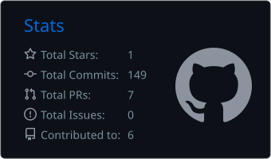
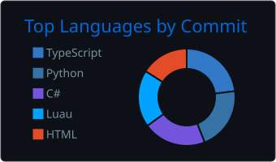
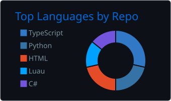

## Helder Augusto

**Software Developer** · Founder of [Maidzinha Interactive Creations](https://maidzinhainteractive.com) · Paraná · Brazil

Developer with 5 years of experience building web applications and automations,
from back-end to interface. I enjoy solving real problems with simple, organized,
easy-to-maintain code, and I'm always learning new technologies.

  
  
  
  
  

---

### What I do

- **Desktop apps**: Windows apps in C# / .NET (WPF) and Electron, with dark themes, anime mascots, and PT-BR / EN support
- **AI assistants**: desktop assistants with voice, long-term memory, and 3D avatars, running on local or cloud LLMs
- **Game development**: desktop companion games, horror-comedy games in Electron + JavaScript, Roblox games in Luau, Unity game mods with BepInEx (C#), and FiveM server scripting in Lua
- **Automation**: PowerShell and Python scripts for installers, builds, and repetitive tasks
- **Best practices**: Git, releases, changelogs, and bilingual documentation (PT-BR / EN)

### ⭐ Main projects

<table>
<tr>
<td width="50%" valign="top">

<h3><a href="https://maidzinha.itch.io/moe-moe-midnight">Moe Moe Midnight</a></h3>

Horror-comedy survival game. Survive from <b>00:00 to 06:00</b> watching the cameras of an abandoned maid café whose android maids still think it's opening night.

<ul>
<li>8 security cameras, steel doors, and power management</li>
<li>5 android maids with unique mechanics and AI that gets more aggressive every hour and every night</li>
<li>6 nights and a true ending</li>
<li>Voiced phone calls, cutscenes, and jumpscares</li>
</ul>

Electron · JavaScript · HTML5 Canvas

</td>
<td width="50%" valign="top">

<h3><a href="https://github.com/Maidzinha/assistente-yui">Assistente Yui</a></h3>

A playful virtual little sister for Windows who chats by <b>voice or text</b>, remembers what you tell her, and helps you use your PC.

<ul>
<li>Voice conversation: speech-to-text and replies spoken sentence by sentence</li>
<li>Expressive voice with emotions (ElevenLabs)</li>
<li>Long-term memory and Windows actions</li>
<li>3D VRM avatar with lip sync and facial expressions</li>
</ul>

Electron · React · TypeScript

</td>
</tr>
</table>

### 🛠️ Studio apps

<table>
<tr>
<td width="50%" valign="top">

<h3><a href="https://maidzinhainteractive.com/projetos.html#maid-deck">Maid Deck</a></h3>

A stream deck in the browser: control <b>OBS Studio</b> from your phone, from anywhere.

Web app · React · TypeScript · Fastify · OBS WebSocket

</td>
<td width="50%" valign="top">

<h3><a href="https://maidzinhainteractive.com/projetos.html#license-manager">Maidzinha License Manager</a></h3>

Create and manage licenses, customers, and payments in one dashboard, with a validation API and offline mode.

Windows app · Python · PySide6 · FastAPI · Ed25519

</td>
</tr>
</table>

### Other projects

| Project | Description | Stack |
|---|---|---|
| [**Maid Installer**](https://github.com/Maidzinha/maid-installer) | Sets up a Windows PC after formatting: WinGet, profiles, post-format kit, local AI, and portable mode (Ventoy) | C# · .NET 10 · WPF |
| [**Luma**](https://maidzinha.itch.io/luma-companheira-virtual) | Virtual desktop companion who fell from the moon: pet her, feed her, chat, play mini-games, and buy outfits (on itch.io) | HTML · JavaScript · Electron |
| [**Orbit**](https://github.com/Maidzinha/orbit) | Screen time tracker with an anime neon look: see which apps you use most, with levels and achievements | JavaScript · Electron |
| [**Desligamento Programado**](https://github.com/Maidzinha/desligamento-programado) | Timer to shut down, restart, sleep, or hibernate the PC | JavaScript · Electron |

### Tech stack

  

  
  
  
  
  
  

### GitHub stats

  
  
  

  

---

Open to opportunities and collaborations. Studio contact: <a href="mailto:contato@maidzinhainteractive.com">contato@maidzinhainteractive.com</a> · Personal: helderaugusto357@gmail.com · <a href="https://maidzinhainteractive.com">maidzinhainteractive.com</a>
