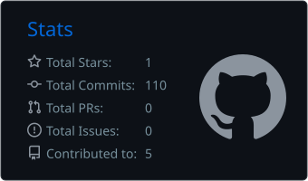
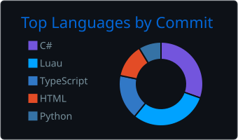
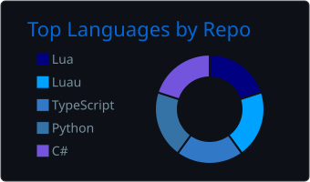

## Helder Augusto da Silva

**Software Developer** · Juranda, PR · Brazil

Developer with 5 years of experience building web applications and automations,
from back-end to interface. I enjoy solving real problems with simple, organized,
easy-to-maintain code, and I'm always learning new technologies.

  
  

---

### What I do

- **Desktop apps**: Windows apps in C# / .NET (WPF), like [Maid Installer](https://github.com/Maidzinha/maid-installer), a post-format PC setup tool with WinGet, profiles, themes, and a local AI assistant
- **AI assistants**: desktop assistants with voice, long-term memory, and 3D avatars (Electron + React + TypeScript), running on local or cloud LLMs
- **Game development**: Roblox games in Luau, Unity game mods with BepInEx (C#), and FiveM server scripting in Lua
- **Automation**: PowerShell and Python scripts for installers, builds, and repetitive tasks
- **Best practices**: Git, changelogs, and bilingual documentation (PT-BR / EN)

### Tech stack

  

  
  
  
  
  

### GitHub stats

  
  
  

  

---

Open to opportunities and collaborations. Reach me by email: helderaugusto357@gmail.com
